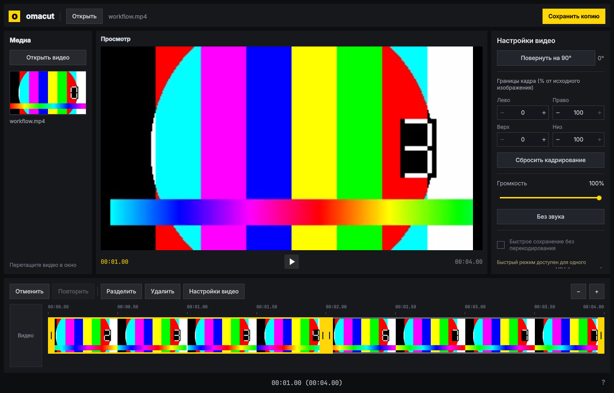

# Omacut

A single-window editor for short videos with a dark editing workspace, media bin, preview, video inspector and one ripple timeline. Open a video, trim either end, split it into clips and cut pieces out, add more videos and put the clips in any order, preview the result, and export. On Omarchy, the interface follows your theme's accent color.

Built using **Qt Quick (QML)** UI with the Material style — the same Qt stack Quickshell builds on — and **ffmpeg** for the cut. The C++ side compiles to a single executable; the QML is embedded in it via Qt resources.



## Replace the built-in Omacut on Omarchy

This fork keeps the `omacut` package/binary/desktop ID, so existing Open With integration and launcher shortcuts continue to work. Run as your regular user; `makepkg` asks for sudo only when installing dependencies and replacing the package:

```bash
git clone --branch codex/short-editor https://github.com/6axam/omacut.git "$HOME/omacut-upgraded" && cd "$HOME/omacut-upgraded" && bin/install
```

Then launch **Omacut** from **Super+Space** or run `omacut recording.mp4`. To try without replacing the system package, use `bin/install --user` and `~/.local/bin/omacut`. To return to the repository package later, run `sudo pacman -S omacut`; if you installed the user override, remove only `~/.local/bin/omacut` and `~/.local/share/applications/omacut.desktop` first.

## Editing

The timeline shows the remaining clips in playback order. Split and Delete act on the selected clip under the playhead; removing a clip closes the gap immediately. Drag either edge to trim, click or drag the track to seek, and use +/− or Z to zoom. During a trim the scale and thumbnails hold still; on release the edit closes up. One drag is one undo step.

For a screen recording: open it, seek to 00:02 and press Ctrl+Space to trim the start. Split at both ends of a pause, click inside that segment, and Delete. Space previews the surviving parts with audio. Save copy chooses a new MP4 beside the source.

The inspector applies crop (percentages of the source image), quarter-turn rotation and volume/mute to the whole video. Preview uses the same crop-then-rotate order as export. On narrow windows the inspector is available from Video settings.

Saving re-encodes by default for precise cuts. Originals cannot be overwritten, including through symbolic or hard links. A separate **Fast save without re-encoding** option is available for a continuous compatible H.264/AAC MP4 segment without transformations. Fast mode follows keyframes, so its actual start and duration can shift. Export displays progress, can be cancelled, and writes to a temporary sibling file before an atomic rename. Cancellation and errors remove partial files and preserve an existing target.

Opening works through the desktop portal, a file argument (`omacut recording.mp4`), Open With in the file manager, or a file drop. Omarchy's accent, rounding and language continue to update live. New controls include Russian and Ukrainian translations.

Handles catch on neighbouring clip edges and the playhead.

Confirmations are answered from the keyboard: the arrows and Tab move between the buttons, Enter presses one, a button's underlined letter presses that one (with or without Alt), and Escape backs out.

## Hotkeys

- *Space*: Start/stop video playback.
- *0–9*: Jump to 0%–90% of the edit.
- *Left/Right*: Step one frame while paused; seek one second while playing.
- *Shift+Left/Right*: Move the playhead by 5 seconds.
- *Alt+Left/Right*: Pause and move the playhead by one video frame. Hold to move it by 0.2 seconds at a time.
- *[ / ]*: Jump to the previous / next clip edge.
- *S*: Split the clip at the playhead.
- *X, Delete*: Remove the clip under the playhead.
- *Alt+[ / Alt+]*: Move the clip under the playhead earlier / later.
- *Ctrl+Space*: Move the start of the clip under the playhead to the playhead.
- *Ctrl+Shift+Space*: Move the end of the clip under the playhead to the playhead.
- *Ctrl+Z / Ctrl+Shift+Z*: Undo / redo.
- *Z*: Zoom to the clip under the playhead for fine tuning (Z again zooms back out).
- *F*: Save the frame under the playhead as a PNG next to its video.
- *Ctrl+O*: Open a new file to edit.
- *Ctrl+Shift+O*: Add a video after the clip under the playhead.
- *Ctrl+S*: Export the current edit.
- *Q*: Quit (asks first if the edit hasn't been exported).
- *?*: Show the hotkeys in the app.

## Install

For this edited checkout, run `bin/install --user` to install `~/.local/bin/omacut` and a user launcher entry that opens this version. In Omarchy press **Super+Space** and select **Omacut**; Open With uses the same desktop entry. If `/usr/bin` precedes `~/.local/bin` on PATH, use the explicit `~/.local/bin/omacut` in a terminal.

`bin/install` builds and installs the local Arch package with `makepkg -fsi` (requires administrator authentication). The system package's original launcher integration and MIME types are preserved. Running `build/omacut [VIDEO]` directly needs no installation.

## Requirements

- `xdg-desktop-portal` and a portal backend for the file picker
- `ffmpeg` and `ffprobe` on your PATH (used at runtime)

Exports are always written as MP4 files, regardless of the input video's container. The export dialog offers Original/1080p/720p quality — never upscaling, and always preserving the aspect ratio. When clips come from different videos, the export takes the frame size of the first clip's video; clips of another shape are letterboxed into it, and videos without sound get silence.

## Build

Built with CMake:

```bash
bin/build
```

This produces a single `omacut` binary in `build/`.

Requirements: a C++17 compiler, `cmake`, and Qt 6 (`qt6-base`, `qt6-declarative`, `qt6-multimedia`). The package's PKGBUILD in `omacom/omarchy-pkgs` lists everything, and CI installs from it.

## Test

```bash
bin/test
```

Runs the Qt Test suite through `ctest`; it needs `ffmpeg` to make its sample videos. The tests run offscreen with Qt's software renderer, so no windows open and screenshots hold real pixels. Any QML warning fails the test that caused it.

`qmlTimelineViewDependsOnlyOnTheEdit` makes random edits the way a person might (splits, trims, handle drags, joins, moves, removals, added videos, zooms, undo and redo) and after each one checks the timeline against a freshly opened editor showing the same edit, down to the pixel. It also checks that the zoomed-out track is covered end to end, that clips close up after edits, and that nothing in the filmstrip reloads or moves during a drag. When it fails, it prints the edits that led there and saves both pictures to `/tmp`. Run it longer, or against a real recording, before a release:

```bash
OMACUT_FUZZ_SEEDS=50 OMACUT_FUZZ_VIDEO=~/Videos/some-recording.mp4 build/omacut_tests qmlTimelineViewDependsOnlyOnTheEdit
```

`scenario_tests` generates an 8-second video with binary frame IDs and known audio, performs `[2,4] + [6,8]`, checks all 100 expected frames, the four-second duration, waveform synchronization and the source hash. It also checks silent inputs, crop/rotation/volume, save-dialog snapshots, source aliases, progress, stream-copy eligibility and partial-file cleanup after cancellation, failure and shutdown.

`qmlShortEditingWorkflow` drives the real QML buttons, shortcuts, portal selection responses, preview play/pause and export. `qmlPreviewUsesDisplayedAspect` checks metadata-rotated video. The portal tests emulate desktop responses; choosing a real file in the OS dialog and dragging from your particular file manager remain useful manual integration checks.

For rendering real video pixels in the GUI test (Qt's software scene graph does not render VideoOutput):

```bash
OMACUT_TEST_ON_SCREEN=1 QT_QPA_PLATFORM=offscreen QT_QUICK_BACKEND=rhi QSG_RHI_BACKEND=opengl build/omacut_tests qmlShortEditingWorkflow
```

Set `OMACUT_TEST_ON_SCREEN=1` without the offscreen overrides to watch tests in real windows instead.

## Headless use

```bash
build/omacut check recording.mp4 --json
build/omacut export recording.mp4 copy.mp4 --clips 2:4,6:8 --json
build/omacut export recording.mp4 copy.mp4 --rotate 90 --crop 0.1,0.1,0.8,0.8 --volume 0.5 --json
```

Run `build/omacut --help` for the options. Times are source seconds; crop coordinates are normalized before rotation. `--fast` explicitly opts into keyframe-based stream copying. SIGINT/SIGTERM cancel export and clean up. JSON errors go to stderr and return exit status 1.

## Local validation

On 2026-11-21, `bin/test` passed all 95 Qt/backend/QML cases and 10 export-scenario cases on Qt 6.12. The real QML workflow also passed with the OpenGL renderer, including an exact paused frame from a 1 fps video, metadata rotation, crop-field typing and Russian layout. The generated 25 fps edit contains exactly the expected 100 frames in four seconds; audio correlations before/after the cut exceed 0.999 with zero-sample offset, and the original SHA-256 stays unchanged. The Arch package was built and its contents inspected. Launching the installed desktop entry with `gio launch ... recording.mp4` was checked offscreen; native portal responses and drops are exercised by Qt tests rather than clicks in a particular file manager.

## License

MIT. See `LICENSE`.
